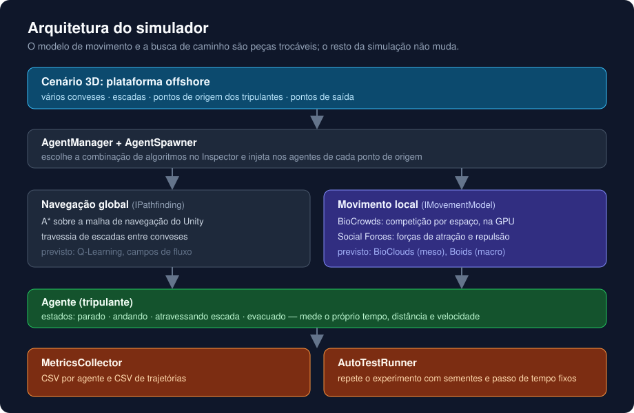
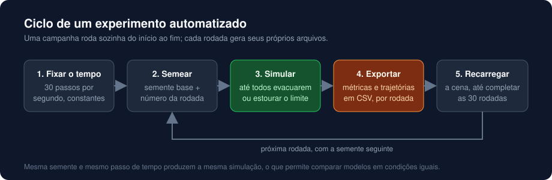
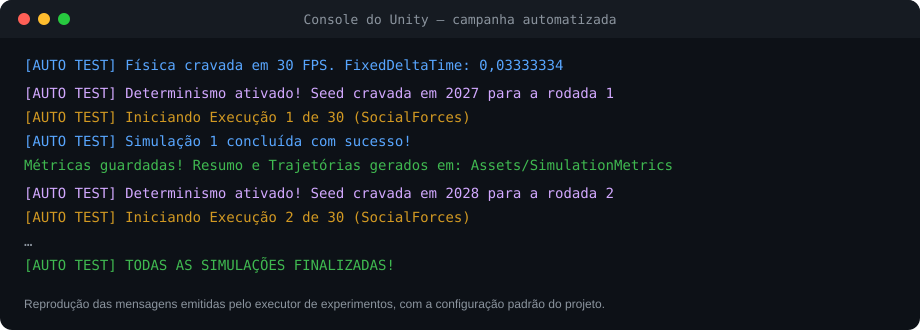

# Simulação de evacuação em plataforma offshore

Simulador 3D em Unity que reproduz a evacuação da tripulação de uma plataforma de petróleo e compara **modelos de movimento de multidões** nas mesmas condições, com experimentos automatizados e reprodutíveis.

> Projeto de pesquisa desenvolvido como voluntário no **ECOLAB**, vinculado ao **C3 — Centro de Ciências Computacionais da FURG**. A pesquisa está em andamento: o código-fonte e os resultados ficam privados até a publicação. Esta página descreve o funcionamento e a arquitetura.

## O problema

Em uma emergência numa plataforma offshore, o tempo até todos chegarem aos pontos de saída depende do desenho dos conveses, das escadas e do comportamento das pessoas em corredores estreitos. Testar isso com gente de verdade é caro e arriscado. A simulação permite comparar cenários e modelos antes de qualquer exercício real.

O desafio de pesquisa é que **modelos diferentes de multidão dão respostas diferentes**. Para comparar, é preciso rodar todos no mesmo cenário, com as mesmas condições iniciais, e medir as mesmas coisas.

## O que o simulador faz

- Simula tripulantes saindo de vários pontos de uma plataforma com múltiplos conveses, ligados por escadas.
- Troca o modelo de movimento por uma opção no Inspector, sem mexer no resto da simulação.
- Mede, para cada agente, o tempo de evacuação, a distância percorrida e a velocidade média, e grava a trajetória ao longo do tempo.
- Roda campanhas inteiras sozinho (30 execuções por padrão), cada uma com sua semente, e exporta um CSV por execução.

## Arquitetura

A ideia central é separar **para onde ir** de **como andar**:

| Camada | Responsabilidade |
|---|---|
| **Navegação global** (`IPathfinding`) | Calcula a rota até a saída. Hoje usa A* sobre a malha de navegação do Unity, com travessia de escadas entre conveses. |
| **Movimento local** (`IMovementModel`) | Decide o deslocamento a cada passo de física, desviando de pessoas e paredes. É aqui que os modelos de multidão entram. |
| **Agente** | Segue a rota usando o modelo escolhido e registra as próprias métricas. |
| **Coleta de métricas** | Reúne os registros de todos os agentes e exporta em CSV. |
| **Executor de experimentos** | Repete a simulação com tempo e sementes controlados. |

### Modelos de movimento

- **BioCrowds**: baseado em competição por espaço. O ambiente é coberto por marcadores, e cada agente só pode usar os marcadores mais próximos dele do que de qualquer outro. O movimento livre de colisão surge dessa disputa. A etapa mais cara, decidir qual agente fica com cada marcador, roda na **GPU** com um *compute shader*.
- **Social Forces** (Helbing): cada agente sofre uma força que o puxa para o objetivo e forças de repulsão de outras pessoas e das paredes.

A estrutura já prevê modelos de outras escalas, como **BioClouds** (mesoscópico) e campos de fluxo (macroscópico).

## Experimentos reprodutíveis

Comparar modelos só faz sentido se cada execução puder ser repetida. O executor de experimentos:

- **fixa o passo de tempo** da física, para o resultado não depender da velocidade do computador;
- **semeia o gerador aleatório** com a semente base mais o número da rodada;
- **encerra cada rodada** quando todos os agentes evacuam ou quando o tempo limite estoura;
- **exporta dois arquivos por rodada**, nomeados com o modelo e o número da execução.

### Dados exportados

| Arquivo | Uma linha por | Colunas |
|---|---|---|
| Métricas | agente | identificador, tempo de evacuação (s), distância percorrida (m), velocidade média (m/s) |
| Trajetórias | agente a cada intervalo | identificador, instante (s), posição X, posição Z |

## Decisões de projeto

**Modelos atrás de uma interface.** Cada modelo de movimento implementa o mesmo contrato de um método. O cenário, a navegação, as métricas e o executor são idênticos para todos, então a diferença nos resultados vem do modelo e não da montagem do teste.

**Um único disparo de GPU por passo de física.** A instância do BioCrowds é compartilhada por todos os agentes. O primeiro agente a pedir o deslocamento em cada passo dispara o cálculo para todos, e os demais apenas leem o resultado.

**Tempo controlado pelo passo de física, não pelo quadro.** Um quadro de vídeo pode conter nenhum ou vários passos de física. Usar o tempo da física como referência evita cálculos repetidos ou pulados.

**Escadas como estado próprio.** Ao entrar numa escada, o agente muda para o estado "atravessando", é conduzido até a outra ponta e só então volta a ser controlado pelo modelo de movimento. A distância e o tempo continuam sendo medidos durante a travessia.

**Métricas medidas pelo próprio agente.** Cada agente acumula sua distância e marca seu tempo, e entrega o registro ao coletor ao evacuar. Isso mantém a medição igual para qualquer modelo.

## Frente de desempenho

Em paralelo ao simulador, o projeto inclui um estudo de desempenho da etapa de atribuição de marcadores do BioCrowds na GPU, comparando a busca exaustiva com uma **grade espacial uniforme**, com protocolo de medição próprio (aquecimento, amostras pareadas, ordem embaralhada e validação contra uma referência em CPU).

## Tecnologias

Unity 6 · C# · HLSL (compute shaders) · NavMesh · Burst e Jobs · CUDA (estudo de desempenho)

## Situação

- Pesquisa em andamento no ECOLAB/C3/FURG.
- Resultados numéricos e código serão divulgados com a publicação do trabalho.
- Capturas de tela e vídeo do simulador serão adicionados a esta página.

## Créditos

- O algoritmo BioCrowds foi proposto por Alessandro de Lima Bicho em *Simulating crowds based on a space colonization algorithm*.
- O modelo Social Forces foi proposto por Dirk Helbing e Péter Molnár.
- O modelo 3D da plataforma é um recurso de terceiros.

---

As imagens desta página são diagramas e reproduções, não capturas de tela.

Contato: [github.com/yuriserra1](https://github.com/yuriserra1)
